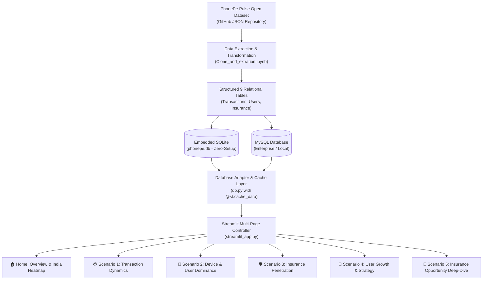

# 📊 PhonePe Pulse: India Transaction & Consumer Insights Dashboard

[](https://phonepe-transaction-insights-e2r9dfde4zpq6lhixzccvc.streamlit.app/)
[](https://www.python.org/)
[]()
[](https://plotly.com/)
[](LICENSE)

---

## 🌐 Live Working App

🔗 **Live App Link**: [👉 https://phonepe-transaction-insights-e2r9dfde4zpq6lhixzccvc.streamlit.app/](https://phonepe-transaction-insights-e2r9dfde4zpq6lhixzccvc.streamlit.app/)

> ✨ Anyone with the link above can view and interact with the live PhonePe Pulse Dashboard!

---

## 📌 Executive Summary

**PhonePe Pulse Insights** is an interactive, production-ready Streamlit analytics application that decodes India's digital payment ecosystem. By parsing and modeling millions of data points from the **PhonePe Pulse Open Data** repository across transactions, user demographics, and insurance policies, this platform provides actionable regional intelligence, growth analytics, and strategic market expansion insights.

### 🌟 Key Highlights
- **100% Cloud-Deployable**: Bundled with a lightweight, optimized SQLite database (`phonepe.db`) so the app deploys seamlessly on **Streamlit Community Cloud** with **zero external database dependencies**.
- **Dual-Database Support**: Automatically uses SQLite out-of-the-box, or connects to external **MySQL** (locally or cloud-hosted via Streamlit Secrets).
- **Blazing Fast Performance**: In-memory query caching via `@st.cache_data` delivers sub-second chart rendering and responsive filtering.
- **Interactive Multi-Page Architecture**: Built using modern Streamlit navigation (`st.navigation`) across 6 specialized analytical modules.

---

## 🏗️ Architecture & Workflow



---

## 🖥️ Dashboard Scenarios & Modules

| Module | Name | Key Business Question & Visualizations |
| :--- | :--- | :--- |
| **Home** | **Overview & Heatmap** | National KPIs (Total Volume, Value, Avg Ticket Size), Interactive India Choropleth Heatmap, Top 10 States. |
| **Scenario 1** | **Transaction Dynamics** | Growth trends (Count & Value), Payment Category Split (P2P, Merchant, Utility), QoQ State Growth Winners & Laggards. |
| **Scenario 2** | **Device & User Dominance** | Smartphone brand market share (Xiaomi, Samsung, Vivo, etc.), App Open Velocity, and Engagement Ratios. |
| **Scenario 3** | **Insurance Penetration** | Policy adoption rate per user, average premium sizes, and State-wise Insurance Opportunity Matrix. |
| **Scenario 4** | **User Growth & Strategy** | State & district registered users vs app opens, identify high-intent digital markets. |
| **Scenario 5** | **Insurance Opportunity** | District-level premium values, policy ticket sizes, and targeted expansion hotspots. |

---

## 🚀 Instant Deployment on Streamlit Community Cloud (Free)

Deploying this app so **anyone can view it online** takes under 2 minutes:

1. **Fork or Push** this repository to your GitHub account:
   ```bash
   git push origin main
   ```
2. Navigate to [share.streamlit.io](https://share.streamlit.io/) and log in with your GitHub account.
3. Click **"Create app"** (or **"New app"**).
4. Fill in the deployment details:
   - **Repository**: `your-username/PhonePe-Transaction-Insights`
   - **Branch**: `main`
   - **Main file path**: `streamlit_app.py`
5. Click **"Deploy!"**
6. Copy your public app URL (e.g. `https://<your-app>.streamlit.app`) and paste it into the [Live Working App](#-live-working-app) section above!

> [!TIP]
> The app comes with `phonepe.db` pre-bundled, meaning **no database configuration is required** for deployment! It will run out of the box on Streamlit Cloud.

---

## ⚙️ Connecting to External MySQL (Optional)

If you prefer to connect the dashboard to a live MySQL database instead of the embedded SQLite database:

### On Streamlit Community Cloud:
Add your MySQL credentials in **App Settings ➔ Secrets**:
```toml
[mysql]
host = "your-database-host.com"
port = 3306
user = "your_username"
password = "your_password"
database = "phonepe"
```

### In Local Development:
Create a `.streamlit/secrets.toml` file or set environment variables:
```toml
# .streamlit/secrets.toml
[mysql]
host = "localhost"
port = 3306
user = "root"
password = "your_password"
database = "phonepe"
```

---

## 💻 Local Quickstart

### 1. Clone the Repository
```bash
git clone https://github.com/gopinath-sara1n/PhonePe-Transaction-Insights.git
cd PhonePe-Transaction-Insights
```

### 2. Create a Virtual Environment & Install Dependencies
```bash
# Create virtual environment
python -m venv .venv

# Activate virtual environment
# Windows (PowerShell):
.venv\Scripts\Activate.ps1
# macOS/Linux:
source .venv/bin/activate

# Install required packages
pip install -r requirements.txt
```

### 3. Run the Streamlit Application
```bash
streamlit run streamlit_app.py
```
The application will launch in your browser at `http://localhost:8501`.

---

## 🗄️ Relational Database Schema

The database houses 9 relational tables structured from the PhonePe Pulse pulse feed:

| Table Category | Tables Included | Granularity |
| :--- | :--- | :--- |
| **Aggregated** | `aggregated_transaction`, `aggregated_user`, `aggregated_insurance` | State, Year, Quarter |
| **Map (Geographical)** | `map_transaction`, `map_user`, `map_insurance` | State, District, Year, Quarter |
| **Top (Rankings)** | `top_transaction`, `top_user`, `top_insurance` | District-level Top Performers |

---

## 📂 Project Structure

```text
PhonePe-Transaction-Insights/
├── .streamlit/
│   └── config.toml             # PhonePe Purple theme & server configuration
├── Home_Page.py                # Dashboard Home: India choropleth & high-level KPIs
├── Scenario_1.py               # Module 1: Transaction Dynamics & Category Transitions
├── Scenario_2.py               # Module 2: Mobile Device Dominance & Engagement
├── Scenario_3.py               # Module 3: Insurance Penetration & Market Opportunity
├── Scenario_4.py               # Module 4: User Growth & District Expansion Strategy
├── Scenario_5.py               # Module 5: Insurance Engagement Deep-Dive
├── streamlit_app.py            # Streamlit Multipage Navigation & Application Controller
├── db.py                       # Centralized DB Adapter (SQLite / MySQL + @st.cache_data)
├── phonepe.db                  # Embedded, zero-config SQLite Database (3.9 MB)
├── india_states.geojson        # High-performance local GeoJSON for map rendering
├── Clone_and_extration.ipynb   # Raw JSON Extraction Pipeline notebook
├── PhonePe_Project_Insigths.pptx # Project presentation slide deck
├── requirements.txt            # Streamlit Cloud deployment dependencies
├── .gitignore                  # Git ignore rules
└── README.md                   # Documentation with Live App Link & deployment guide
```

---

## 🛠️ Technology Stack

- **Frontend & App Framework**: [Streamlit](https://streamlit.io/) (v1.35+)
- **Interactive Visualizations**: [Plotly Express](https://plotly.com/python/)
- **Data Manipulation**: [Pandas](https://pandas.pydata.org/)
- **Database Engine**: [SQLite](https://www.sqlite.org/) (Default Zero-Config) / [PyMySQL](https://github.com/PyMySQL/PyMySQL) (Optional External DB)
- **Data Source**: [PhonePe Pulse Official Open Data](https://github.com/PhonePe/pulse)

---

## 📄 License
This project is open-source and available under the [MIT License](LICENSE).
